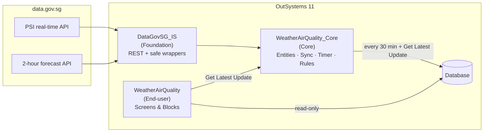
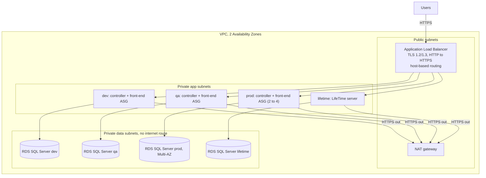

# SG Weather & Air Quality

A full-stack OutSystems 11 application that consumes Singapore's open
government data from [data.gov.sg](https://data.gov.sg): **air quality (PSI)
per region** and the **2-hour weather forecast per area**. Users can see the
current air quality at a glance, search and filter the forecast, and follow
PSI trends over time.

The repository also contains the **Terraform** that defines the AWS
infrastructure for a self-managed OutSystems 11 factory, plus **automated
tests** and CI.

---

## Access

| What | Where |
| --- | --- |
| Live app | https://personal-s1hc9xux.outsystemscloud.com/WeatherAirQuality/ |
| Test user | Not needed: the screens are open to anonymous users (public data). See "Security" below. |
| OutSystems source | [`outsystems/`](outsystems/): exported `.osp` and `.oml` files |
| Tests | [`tests/`](tests/) and `infra/terraform/**/tests` |

> The app runs in an OutSystems 11 **personal environment**, which sleeps after
> about two weeks of inactivity. If it is unavailable, the exported solution
> pack in `outsystems/` can be published to any OutSystems 11 environment.

---

## Features

- **Air quality dashboard:** current 24-hour PSI for North, South, East, West and Central, colour-coded by the official NEA health bands (Good → Hazardous).
- **Drill-down trend:** click a region card to open its PSI chart for the last 24 hours (hourly points, hover for exact values).
- **2-hour forecast page:** the latest forecast for all 47 planning areas, with partial, case-insensitive search by area and filtering by weather condition. Search and filter are optional screen parameters, so a filtered view can be shared as a link (e.g. `/Forecast?SearchText=Ang Mo`).
- **Freshness indicators:** "Last updated" time, a **Get Latest Update** button, and a warning banner when the last successful sync is more than an hour old (sync failing or the API down).
- **Resilience:** if data.gov.sg is down or rate-limits us, the app keeps showing the last known data and records the failure in a sync log.

---

## Architecture



### Modules (OutSystems Architecture Canvas)

| Layer | Module | Responsibility |
| --- | --- | --- |
| Foundation | `DataGovSG_IS` | Consumes the two REST APIs. Public wrappers `Get_PSI` / `Get_TwoHourForecast` never throw: they return `Success`, `ErrorMessage` and the data, and catch all exceptions (timeouts, 429 rate limits, 5xx). |
| Core | `WeatherAirQuality_Core` | Entities, the sync logic (`SyncPSI`, `SyncForecast`), the 30-minute Timer, and business rules such as PSI → health band. Entities are exposed **read-only**, so only Core can write data. |
| End-user | `WeatherAirQuality` | Screens (`Dashboard`, `RegionDetail`, `Forecast`) and the reusable `PSICard` block. No business logic. |

Dependencies only point downwards (UI → Core → IS), so each layer can change
independently.

### Data model

| Entity | Purpose |
| --- | --- |
| `PSIReading` | One row per region per hourly reading (PSI, PM2.5, PM10) |
| `ForecastPeriod` | One row per 2-hour forecast window |
| `AreaForecast` | One row per area within a window (cascade-deleted with its period) |
| `SyncLog` | Audit trail of every sync: time, source, success, records saved, error message |
| `PSIBand` (static) | NEA bands: Good 0–50, Moderate 51–100, Unhealthy 101–200, Very Unhealthy 201–300, Hazardous 301+ |

---

## Key design decisions and trade-offs

Full reasoning is in [`docs/adr`](docs/adr).

1. **Sync into the database instead of calling the API on every page view** ([ADR 0001](docs/adr/0001-sync-data-instead-of-live-calls.md)).
   data.gov.sg is rate-limited (~6 calls per 10 s without an API key) and only returns the latest values. Syncing every 30 minutes makes pages fast, keeps the app working during API outages, and builds the history for trend charts. *Trade-off:* data can be up to 30 minutes old; "Get Latest Update" mitigates this.
2. **Idempotent sync.** Already-stored readings and forecast periods are skipped, so the Timer and manual refreshes can overlap without creating duplicates.
3. **Integration isolated behind safe wrappers.** Every external failure becomes `Success = False` plus a message, logged to `SyncLog`, never an unhandled error on screen.
4. **Read-only entities for consumers.** The UI cannot modify data by accident; all writes go through Core.
5. **Observability.** `SyncLog` shows when data was last refreshed and why a sync failed, and drives the stale-data banner.

### Assumptions

- Public data, so no personal data is stored, and the screens are open to anonymous users.
- No data.gov.sg API key is needed at this volume (2 calls per 30 minutes). The integration module is the single place to add one.
- data.gov.sg timestamps carry an explicit `+08:00` offset. They are stored in UTC (the platform converts them on deserialisation) and Reactive screens display them in the viewer's local time, so Singapore users see SGT.

### Security and operations

- **Anonymous access, throttled refresh.** Service Studio raises a security warning because anonymous users can trigger the `RefreshAll` server action. This is a deliberate trade-off for a public-data demo. To protect the upstream API, `RefreshAll` only calls `SyncAll` if the last successful sync is at least 5 minutes old; otherwise it just reloads stored data. In production, the refresh button would be limited to a registered role.
- **Sync schedule.** The `SyncAll` Timer is set to run **every 30 minutes** in Service Center (Factory → Modules → WeatherAirQuality_Core → Timers → Effective Schedule). Service Studio only offers daily schedules, and the effective schedule is environment configuration, so it is not part of the exported `.oml`. Set it again after importing into a new environment.

---

## Infrastructure as Code (AWS)

[`infra/terraform`](infra/terraform) defines the AWS infrastructure to run a
**self-managed OutSystems 11 factory** (ODC is fully managed by OutSystems, so
only O11 can be self-hosted). See [ADR 0003](docs/adr/0003-terraform-for-self-managed-o11-on-aws.md).



| Module | What it creates |
| --- | --- |
| `network` | VPC over 2 AZs; public, app and data subnets; NAT; the data tier has no internet route |
| `shared` | Encrypted, versioned, private S3 bucket for installers and the license; EC2 role with SSM (no RDP exposed) and least-privilege access |
| `load_balancer` | Internet-facing ALB, HTTPS listener with a modern TLS policy, HTTP→HTTPS redirect, invalid-header dropping |
| `outsystems_environment` | Per environment (dev, qa, prod, lifetime): RDS SQL Server (encrypted, private, RDS-managed password), deployment controller, front-end Auto Scaling group, host-based listener rule, isolated security groups, CloudWatch log group, PowerShell bootstrap using `Outsystems.SetupTools` |

Environments are defined as data in `var.environments`, so all environments
use the same reviewed code. Production differs only in sizing and resilience
(Multi-AZ database, deletion protection, 2–4 front-ends, 30-day backups).

### Usage

```bash
cd infra/terraform
cp terraform.tfvars.example terraform.tfvars   # set acm_certificate_arn etc.
terraform init
terraform plan
terraform apply                                  # requires AWS credentials + an OutSystems license
```

---

## Automated testing

| Layer | Tool | What it covers | How to run |
| --- | --- | --- | --- |
| OutSystems logic | BDDFramework (`WeatherAirQuality_Tests` module) | PSI band boundaries (caught a real label bug), staleness, sync idempotency | [Open the test page](https://personal-s1hc9xux.outsystemscloud.com/WeatherAirQuality_Tests/WeatherAirQualityTests) or run the `outsystems-tests` CI job ([details](tests/outsystems/README.md)) |
| End-to-end | Playwright | Dashboard: 5 regions with health bands, last-updated; clicking a card opens its trend chart. Forecast: >10 areas, partial case-insensitive search narrows the list | `cd tests/e2e && npm install && npx playwright install chromium && APP_URL=<app url> npm test` |
| Infrastructure | `terraform test` (mocked AWS provider) | Prod DB is Multi-AZ, encrypted, private, password managed by RDS; DB reachable only from platform servers; IMDSv2; HTTPS redirect and TLS policy; input validation | `cd infra/terraform && terraform init -backend=false && terraform test` (and the same in each `modules/*`) |
| Infrastructure | TFLint, Checkov | Lint rules and security misconfigurations | CI |

CI ([`.github/workflows/ci.yml`](.github/workflows/ci.yml)) runs formatting,
validation, Terraform tests, TFLint and Checkov on every push. The Playwright
suite and the OutSystems BDD suite (through the BDDTestRunner REST API) run on demand (`workflow_dispatch`) because they target the live
environment (set the `APP_URL` secret; `E2E_USERNAME` / `E2E_PASSWORD` are only
needed if the screens are later restricted to registered users).

---

## Repository structure

```
.
├── outsystems/               # Exported .osp / .oml
├── infra/terraform/          # AWS infrastructure for OutSystems 11
│   ├── modules/              # network, shared, load_balancer, outsystems_environment
│   └── tests/                # platform-level terraform tests
├── tests/
│   ├── e2e/                  # Playwright smoke tests
│   └── outsystems/           # BDDFramework test scenarios
├── docs/adr/                 # Architecture decision records
└── .github/workflows/ci.yml
```

---

## Future improvements

- Retention clean-up Timer (e.g. keep 30 days of readings).
- data.gov.sg API key stored as a Site Property, with retry and back-off on HTTP 429.
- More datasets (rainfall, temperature) behind the same integration pattern.
- AWS: WAF on the ALB, VPC flow logs and ALB access logs, customer-managed KMS keys, end-to-end TLS to the front-ends, enhanced RDS monitoring, CI/CD pipeline (LifeTime API) for promoting apps dev → qa → prod.
